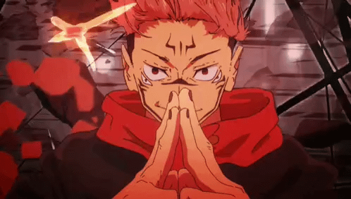

<!-- BANNER SUPERIOR ULTRA DARK -->

<!-- TEXTO DIGITADO (MALEVOLENT SHRINE) - MAIS AGRESSIVO -->

<h1>⛩️ SUKUNA ⛩️</h1>

<!-- SUBTÍTULO MAIS AMEAÇADOR -->

 

<!-- BADGES DE STATUS ULTRA DARK -->

  

<blockquote>
<i>"Se eu não sou o mais forte, então eu simplesmente não preciso de ninguém."</i>
</blockquote>

 

<!-- SEPARADOR DARK -->

 

<!-- SEÇÃO SOBRE MIM -->

━━━━━━━━━━━━ ⛩️ ━━━━━━━━━━━━

  

<table align="center">
  <tr>
    <td align="center" bgcolor="#0A0A0A"><b style="color:#FF0000">👑 Título</b></td>
    <td align="center" bgcolor="#0A0A0A">Rei das Maldições</td>
  </tr>
  <tr>
    <td align="center" bgcolor="#0A0A0A"><b style="color:#FF0000">🔥 Elemento</b></td>
    <td align="center" bgcolor="#0A0A0A">Fogo / Código</td>
  </tr>
  <tr>
    <td align="center" bgcolor="#0A0A0A"><b style="color:#FF0000">⚔️ Área</b></td>
    <td align="center" bgcolor="#0A0A0A">Desenvolvimento Web &amp; Backend</td>
  </tr>
  <tr>
    <td align="center" bgcolor="#0A0A0A"><b style="color:#FF0000">🩸 Técnica Inata</b></td>
    <td align="center" bgcolor="#0A0A0A">Clivar &amp; Desmantelar (bugs)</td>
  </tr>
  <tr>
    <td align="center" bgcolor="#0A0A0A"><b style="color:#FF0000">⛩️ Domínio</b></td>
    <td align="center" bgcolor="#0A0A0A">Santuário Malevolente</td>
  </tr>
  <tr>
    <td align="center" bgcolor="#0A0A0A"><b style="color:#FF0000">💀 Status</b></td>
    <td align="center" bgcolor="#0A0A0A">Desenvolvendo projetos...</td>
  </tr>
  <tr>
    <td align="center" bgcolor="#0A0A0A"><b style="color:#FF0000">📫 Contato</b></td>
    <td align="center" bgcolor="#0A0A0A"><a href="mailto:gabrielsilvaalexandre386@gmail.com" style="color:#DC143C">gabrielsilvaalexandre386@gmail.com</a></td>
  </tr>
</table>

 

<!-- GIF DO SUKUNA (MANTIDO) -->

<i>「Expansão de Domínio: Santuário Malevolente」</i>

 

 

<!-- SEÇÃO ARSENAL TÉCNICO -->

━━━━━━━━━━━━ 🔥 ━━━━━━━━━━━━

  

<h3 style="color:#FF0000">🩸 Linguagens de Ritual</h3>

<h3 style="color:#FF0000">⛩️ Técnicas &amp; Ferramentas</h3>

<h3 style="color:#FF0000">⚔️ Estilo de Combate</h3>

  

 

<!-- SEÇÃO PROJETOS EM DESTAQUE -->

━━━━━━━━━━━━ 🩸 ━━━━━━━━━━━━

  

<table align="center">
  <tr>
    <td align="center">
      
    </td>
    <td align="center">
      
    </td>
    <td align="center">
      
    </td>
  </tr>
</table>

 

 

<!-- SEÇÃO ESTATÍSTICAS -->

━━━━━━━━━━━━ ⛩️ ━━━━━━━━━━━━

  

 

  

 

 

<!-- SEÇÃO DIMENSÕES CONECTADAS (CONTATO) -->

━━━━━━━━━━━━ 🩸 ━━━━━━━━━━━━

  

  

 

<!-- FRASE FINAL -->
<blockquote>
<i>"Curto, mas é o bastante."</i>
 
<b>— Sukuna Ryomen</b>
</blockquote>

 

<!-- CONTADOR DE VISITAS -->

  

<!-- BANNER INFERIOR ULTRA DARK -->

